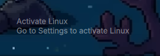

# Watermark

The classic "Activate Linux" watermark for your desktop — but done right.

This is `pix.watermark`, a simple Quickshell overlay that puts the tongue-in-cheek "Activate Linux" text in the bottom-right corner. Built for Omarchy and Hyprland on Wayland. It's click-through (never blocks your mouse), hides itself when windows are open, and uses no external daemons or heavy toolkits.



## Why

Because sometimes you want that nostalgic Windows XP activation watermark back, and nobody should have to run an Electron app or a shell daemon just to display two lines of text. This does it in pure QML on Quickshell's `PanelWindow` with `wlr-layer-shell`.

## Features

- **Smart hiding** — disappears when any window is on the current workspace
- **Click-through** — `ExclusionMode.Ignore`, so your clicks go straight through to whatever's under it
- **No daemons** — no Eww, no Electron, nothing running in the background
- **Update checker** — quietly checks for new releases and notifies you through Omarchy's notification system

## Install

```bash
omarchy plugin add https://github.com/pxllbt/watermark.git --enable
omarchy plugin enable pix.watermark
omarchy restart shell
```

Update later: `omarchy plugin update pix.watermark`

## Development & testing

```bash
omarchy plugin validate .
bash tests/smoke.sh
```

## Project structure

| File | What it does |
|---|---|
| `manifest.json` | Plugin manifest |
| `Watermark.qml` | The overlay component |
| `scripts/check-update.sh` | Update notification helper |
| `tests/smoke.sh` | Validates manifest + scripts |

## License

MIT. By [pxllbt](https://github.com/pxllbt).